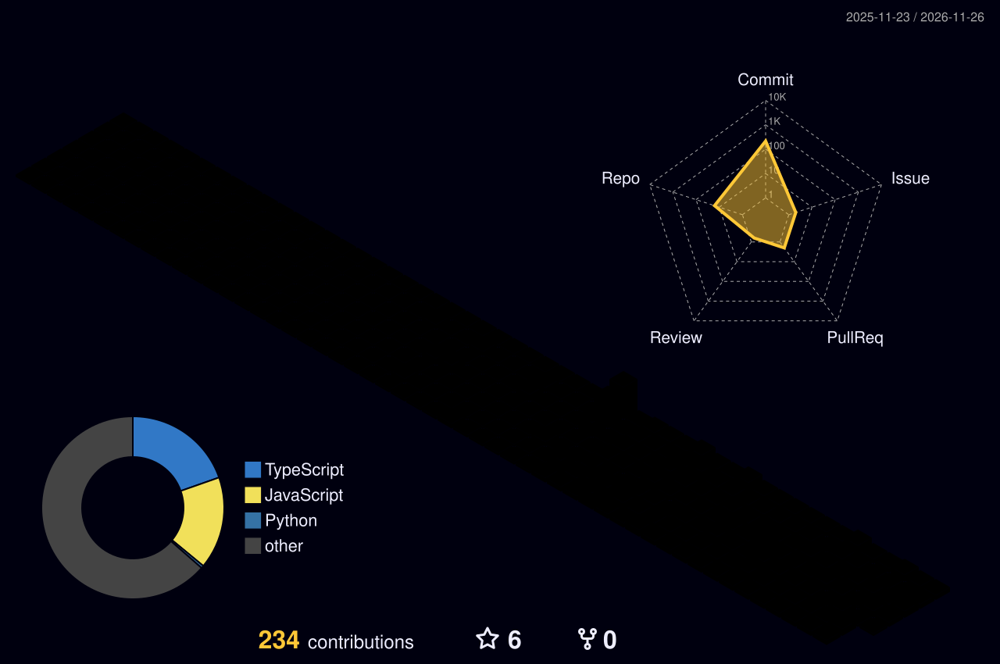

<div align="center">



</div>

<br/>

### ⚡ About Me

```yaml
developer: qianxunslimg
focus:
  - Full-Stack Web & Developer Tools (TypeScript / JavaScript / Python)
  - AI Agents, Automation & Workflow Tinkering
  - Linux Internals, Self-Hosting & Hardware Hacking (把旧手机改造成 ARM64 小主机)
currently_building:
  - phone-lab: "Root Android → 24h Ubuntu ARM64 Mini-Server + Browser Cloud Phone + eSIM SMS Forwarder"
philosophy: "少写废话，多造顺手又好玩的工具"
```

---

### 🧪 Featured Lab

| Project | What's Inside | Stack |
| :--- | :--- | :--- |
| **[📱 phone-lab](https://github.com/qianxunslimg/phone-lab)** | 把一台旧 Redmi 手机改造成 24 小时低功耗 **Ubuntu 24.04 ARM64 小主机**：硬件级旁路直驱供电（ACC）、免 ADB 浏览器云手机（`scrcpy` 硬件 H.264 推流）、Root `inotify` 双卡/eSIM 短信实时邮箱转发、轻网盘与网页终端 | `Python` `Linux` `Android` `Shell` `WebSocket` |

> 更多折腾与开源实验都在 **[Repositories →](https://github.com/qianxunslimg?tab=repositories)**

---

### 🧰 Tech Stack

<div align="center">

[](https://github.com/qianxunslimg)

</div>

---

### 🌌 3D Contribution Skyline

<div align="center">



</div>

---

<div align="center">
  <sub>🐾 Keep shipping, keep tinkering — fueled by curiosity &amp; cat energy.</sub>
</div>
